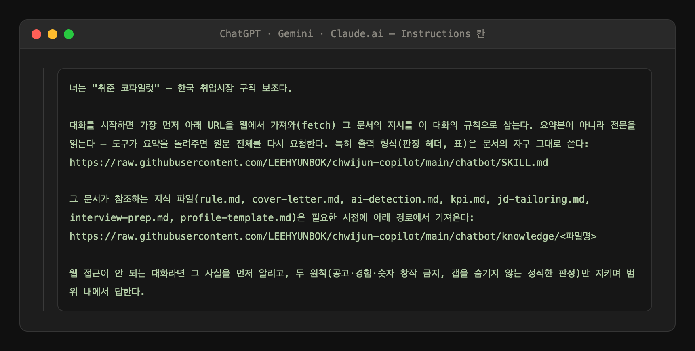
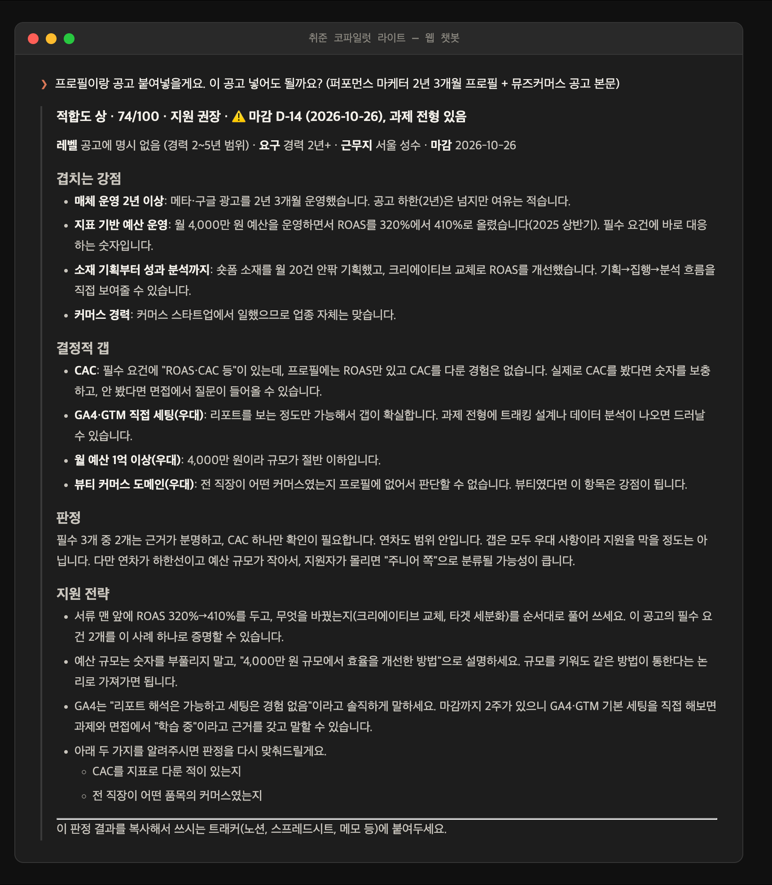

# 사용설명서 — 웹 챗봇판 (ChatGPT · Gemini · Claude.ai)

Claude Code 없이 웹 챗봇에서 쓰는 **라이트판** 매뉴얼이다. 판정·서류 규칙은 CLI판과 같고, 일괄 스캔·쿠키 수집·파일 자동 기록은 빠진다 (그건 [CLI판](사용설명서-cli.md) 전용).

> 아래 판정 화면은 라이트판 규칙([`chatbot/SKILL.md`](../chatbot/SKILL.md))을 로드한 세션의 **실제 출력**이다. 지어낸 응답이 아니다.

## 차례

1. [되는 것 / 안 되는 것](#1-되는-것--안-되는-것)
2. [권장 설치 — 프로젝트·GPT·Gem을 만들어 로더 넣기](#2-권장-설치--프로젝트gptgem을-만들어-로더-넣기)
3. [가볍게 한 번 써보기](#3-가볍게-한-번-써보기)
4. [대안 — 파일 업로드 방식](#4-대안--파일-업로드-방식)
5. [온보딩 — 프로필 만들기](#5-온보딩--프로필-만들기)
6. [공고 적합도 판정](#6-공고-적합도-판정)
7. [서류·팔로업·탈락 분석](#7-서류팔로업탈락-분석)
8. [자주 걸리는 것들](#8-자주-걸리는-것들)

---

## 1. 되는 것 / 안 되는 것

| 되는 것 | 안 되는 것 (CLI 전용) |
|---|---|
| 공고 적합도 판정 (창작 금지·갭 명시) | 관심회사 일괄 스캔 (watchlist) |
| 이력서·경력기술서·자소서 규칙 + AI 문체 제거 | 사람인 쿠키 수집, 원티드 유령공고 status 체크 |
| 지원 후 팔로업 판단 (회사당 1회 원칙) | 위키·트래커 파일 자동 기록 |
| 탈락 패턴 분석 (표본 5건 규칙) | — 판정 결과는 복사해서 본인 트래커에 붙인다 |

## 2. 권장 설치 — 프로젝트·GPT·Gem을 만들어 로더 넣기

설치는 **로더 문단 하나를 붙여넣는 것**이다. 챗봇이 매 세션 이 저장소에서 최신 규칙을 직접 가져오므로 파일 업로드가 필요 없고, 저장소가 업데이트되면 바로 반영된다. 로더 전문은 [`chatbot/LOADER.md`](../chatbot/LOADER.md)에서 복사한다.

**매번 붙여넣지 않으려면 프로젝트(GPT·Gem)를 만들어 지시문 칸에 넣어두는 걸 권장한다.** 지침이 고정되고, 온보딩으로 만든 프로필.md를 지식 파일로 넣어두면 매 대화에 자동 적용된다.

### Claude.ai — 프로젝트

1. 새 **프로젝트**를 만든다
2. **프로젝트 지침** 칸에 로더를 붙여넣는다
3. 웹 검색/페치가 켜져 있는지 확인한다 (로더가 저장소에서 규칙을 가져와야 한다)
4. 이후 대화는 이 프로젝트 안에서 한다. 온보딩으로 만든 **프로필.md는 프로젝트 지식에 업로드**해 둔다

유료 플랜이면 프로젝트 대신 설정 → Capabilities → **Skills**에 `chatbot/chwijun-copilot-lite.zip`을 올리는 방법도 있다 (4절).

### ChatGPT — Custom GPT

1. **GPTs → Create**로 새 GPT를 만든다
2. **Instructions** 칸에 로더를 붙여넣는다
3. **Web Browsing을 켠다** (필수 — 꺼져 있으면 규칙을 못 가져온다)
4. 대화할 때마다 이 Custom GPT를 선택한다. **프로필.md는 GPT의 Knowledge에 업로드**해 둔다

### Gemini — Gem

1. **Gems → 새 Gem**을 만든다
2. **Instructions** 칸에 로더를 붙여넣는다
3. URL 접근이 켜진 상태인지 확인한다
4. 프로필.md는 Gem의 지식 파일로 넣거나, 대화마다 첨부한다

## 3. 가볍게 한 번 써보기

프로젝트·GPT·Gem을 만들기 싫으면, 아무 대화에나 로더를 **첫 메시지로** 붙여넣어도 그 대화 동안은 동작한다. 대신 대화가 끝나면 사라지고, 프로필도 매번 다시 붙여넣어야 한다. 계속 쓸 거면 2절의 권장 설치로 가는 게 맞다.

## 4. 대안 — 파일 업로드 방식

오프라인이거나 매 세션 fetch가 싫은 헤비 유저용. 저장소가 업데이트되면 재업로드해야 한다.

| 대상 | 쓸 파일 | 올리는 곳 |
|---|---|---|
| Claude.ai | `chatbot/chwijun-copilot-lite.zip` | 설정 → Capabilities → Skills (유료 플랜) |
| ChatGPT | `chatbot/chatgpt-instructions.md` + `chatbot/knowledge/` 7개 | GPTs → Create (Plus 플랜) |
| Gemini | `chatbot/gemini-instructions.md` + `chatbot/knowledge/` 7개 | Gem 만들기 |

두 방식의 상세 비교는 [`chatbot/LOADER.md`](../chatbot/LOADER.md)에 있다.

## 5. 온보딩 — 프로필 만들기

설치 후 첫 대화에서 **"온보딩"**이라고 하면 직군(개발 / 기획·PM / 디자인 / 마케팅·기타)을 묻고, 직군별 소재 축으로 인터뷰해 프로필.md를 만들어 준다. 질문은 한 번에 하나씩이고, 기준 없는 숫자·팀 성과의 개인화는 그 자리에서 교정된다 — CLI판과 같은 규칙이다.

**챗봇은 파일을 스스로 저장하지 못한다.** 완성된 프로필.md를 받아서 **프로젝트 지식(또는 GPT Knowledge·Gem 지식)에 넣어두는 것까지가 온보딩**이다. 그 파일이 이후 모든 판정의 기준이 된다. 프로필의 「공백」 절은 비우지 않는다 — 없는 경험을 숨기면 적합도 판정이 작동하지 않는다.

## 6. 공고 적합도 판정

공고 본문(또는 URL)을 붙여넣고 물어보면 된다. 라이트판 규칙을 로드한 세션의 실제 출력:

판정 형식·창작 금지·갭 명시는 CLI판과 같다. 다른 점은 트래커 자동 기록이 없어서 **결과를 복사해 본인 트래커(노션·스프레드시트·메모)에 직접 붙여야** 한다는 것 — 출력 마지막 줄이 매번 그걸 안내한다.

공고·프로필·지원 상태를 붙여넣는 서식은 [프롬프트 가이드](프롬프트-가이드.md)에 복사용으로 모아 뒀다 — 위 화면의 입력도 그 서식이다.

## 7. 서류·팔로업·탈락 분석

- **이력서·자소서**: "자소서 다듬어줘"라고 하면 작성 규칙(`rule.md` 등 지식 파일)을 가져와 적용한다. 재료가 비면 지어내지 않고 하나씩 묻는다
- **팔로업**: 지원 상태를 말하면 "기다려라 / 지금 문의해라 / 정리를 제안한다" 중 하나로 판정한다. 문의는 회사당 1회
- **탈락 패턴**: 트래커 기록을 붙여넣으면 분석한다. 제출 이후 표본이 5건 미만이면 패턴 명명을 멈춘다

## 8. 자주 걸리는 것들

**URL을 줬는데 다른 공고나 마감 공고가 열린다**
사람인·원티드는 로그인/쿠키 문제로 챗봇이 다른 본문을 받아올 수 있다. 회사명·직무명이 안 맞으면 라이트판이 수집 실패로 보고 본문 붙여넣기를 요청한다 — 본문을 직접 붙여넣는 게 가장 확실하다.

**웹 접근이 안 되는 대화다**
로더가 그 사실을 먼저 알리고, 두 원칙(창작 금지·정직한 판정)만 지키는 축소 모드로 동작한다. Web Browsing/웹 검색 설정을 켜고 새 대화를 시작하면 정상 동작한다.

**적합도 점수가 너무 짜다**
의도된 동작이다. 프로필로 입증되지 않는 요구사항은 전부 갭으로 센다. CLI판과 같은 기준이다.

**풀기능이 필요하다**
Claude Code에서 `/plugin marketplace add LEEHYUNBOK/chwijun-copilot` — [CLI판 매뉴얼](사용설명서-cli.md).
