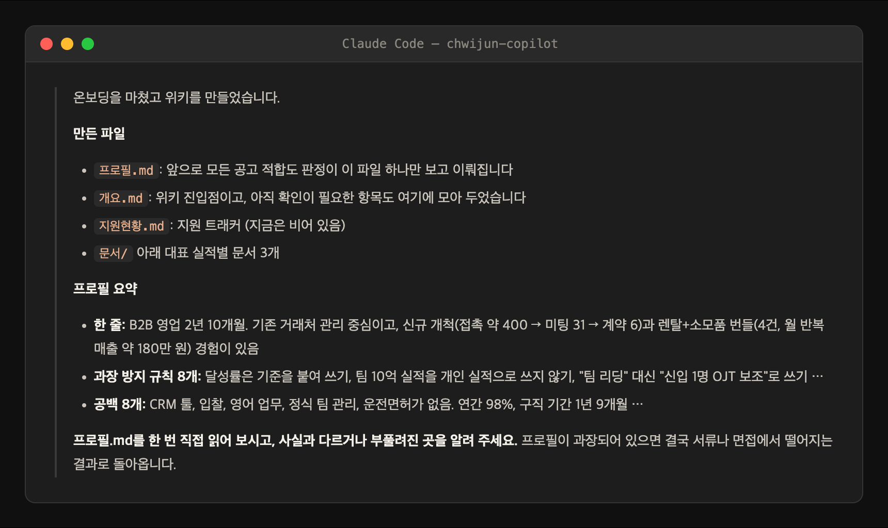
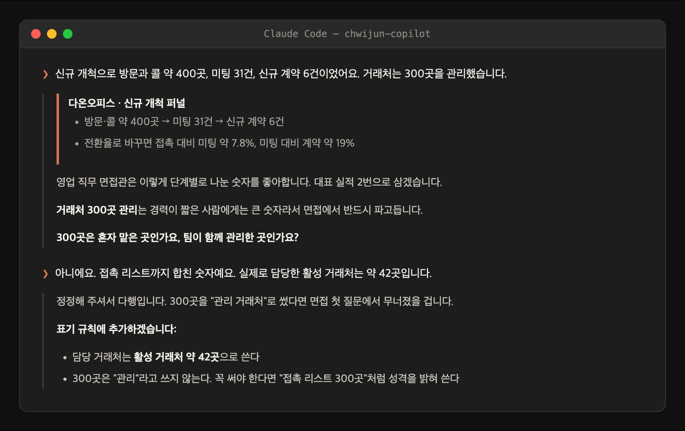

# 실전 워크플로우 — 일하면서 쌓고, 위키로 지원한다

도구 사용법이 아니라 **운용 방법** 가이드다. 이 플러그인을 만든 사람이 실제 구직 기간에 수십 개 회사에 지원하며 돌린 방식을 일반화했다. 핵심 아이디어는 하나다:

> **서류는 지원 직전에 쓰는 게 아니라, 위키에 쌓아둔 소재에서 꺼내는 것이다.**

지원 마감 전날에 "내가 뭘 했더라"를 떠올리면 과장이 섞이고, 과장은 서류가 아니라 **면접에서** 무너진다. 소재를 겪은 직후에 기록해 두면 숫자와 한계가 함께 남는다.

## 차례

1. [경력 위키 — 구조와 역할](#1-경력-위키--구조와-역할)
2. [소재 기록 — 일하면서 겪은 걸 문서로](#2-소재-기록--일하면서-겪은-걸-문서로)
3. [프로필 갱신 — 문서가 생기면 프로필에 반영](#3-프로필-갱신--문서가-생기면-프로필에-반영)
4. [지원 사이클 — 판정부터 탈락 기록까지](#4-지원-사이클--판정부터-탈락-기록까지)
5. [정정 — 사실이 바뀌면 위키부터](#5-정정--사실이-바뀌면-위키부터)
6. [주기 — 언제 뭘 돌리나](#6-주기--언제-뭘-돌리나)

---

## 1. 경력 위키 — 구조와 역할

온보딩(`/chwijun-copilot:wiki-bootstrap`)이 만들어 주는 구조가 출발점이다:

| 파일 | 역할 |
|---|---|
| `프로필.md` | **모든 판정의 유일한 기준.** 한 줄 요약 · 연차 · 스킬 · 대표 작업 · 「공백」 · 「표기 규칙」 |
| `문서/*.md` | 소재별 상세 문서. 프로필의 "대표 작업"이 여기로 링크된다 — 근거가 사는 곳 |
| `지원현황.md` | 지원 트래커. 상태·날짜·판정이 쌓여야 팔로업과 패턴 분석이 돈다 |
| `개요.md` | 진입점 + 아직 확인 못 한 항목(`{{추가 확인}}`)의 모음 |

구조의 요점: **프로필은 짧게, 근거는 문서로.** 프로필이 길어지면 판정이 흐려지고, 문서가 없으면 면접에서 깊이가 안 나온다.



## 2. 소재 기록 — 일하면서 겪은 걸 문서로

위키는 온보딩 때 한 번 만들고 끝나는 게 아니라, **일이 끝날 때마다 자라는 것**이다.

**언제 기록하나** — 사건이 "끝난 직후"가 기준이다. 숫자가 아직 손에 있을 때:

- 장애·사고를 수습했을 때 (개발)
- 프로젝트·기능·캠페인이 끝나고 결과 숫자가 나왔을 때
- 협상·계약·제안이 매듭지어졌을 때 (영업·사업)
- 리뉴얼·실험의 전후 지표가 나왔을 때 (디자인·마케팅)

**어떻게 기록하나** — 양식은 `templates/위키문서.md`. 골격은 세 토막이다:

```
문제 (상황): 무엇이 왜 문제였나 — 숫자로 (예: 접수 이탈률 40%)
내가 한 일: 내 몫만. 남의 몫은 이름 붙여 구분 (예: 최종 승인은 팀장, 제작은 디자이너)
결과: before → after (예: 40% → 28%, 출시 전후 4주 비교)
```

기록할 때 지켜야 플러그인이 제값을 하는 규칙:

- **숫자는 기준과 함께.** "120% 달성"이 아니라 "분기 개인 목표 2,500만 원 대비 120%". 기준 없는 숫자는 나중에 본인도 못 믿는다
- **남이 한 일을 내 것처럼 쓰지 않는다.** 이력서에 옮길 때가 아니라 기록할 때부터
- **「주의」 절을 채운다** — 이 소재를 인용할 때 틀리기 쉬운 지점 (예: "같은 시기 쿠폰 캠페인이 겹쳐 단독 효과는 측정 못 함"). 이게 서술의 한계선이고, 면접에서 무너지지 않는 안전장치다
- 플러그인에게 "이거 위키에 기록해줘"라고 소재를 불러주면 된다 — 기준 없는 숫자, 남의 몫 혼입은 기록 단계에서 걸러진다:



## 3. 프로필 갱신 — 문서가 생기면 프로필에 반영

새 문서가 생기면 프로필도 따라간다. 갱신은 세 군데다:

1. **대표 작업** — 새 소재가 기존 3~5개보다 강하면 교체하고, 문서로 링크를 건다
2. **공백** — 새 경험으로 메워진 공백은 지운다. 공백 절이 비어 있으면 안 되지만, 낡아 있어도 안 된다
3. **표기 규칙** — 기록하며 정한 표현 제한("팀 리딩이라 쓰지 않는다" 등)을 추가한다

프로필을 바꿨으면 한 번 소리 내 읽어 보라 — **레퍼런스 체크에서 검증 가능한 문장만** 남아 있어야 한다.

## 4. 지원 사이클 — 판정부터 탈락 기록까지

위키가 준비됐으면 지원은 루프다:

```
공고 발견 ──→ 적합도 판정 ──→ 맞춤 서류 ──→ 제출 ──→ 상태 갱신 ──→ 팔로업
 (job-scan)     (job-fit)    (resume-writing)         (지원현황.md)  (apply-followup)
                   │                                                   │
                   └── 부적합이면 넣지 않는다                            └── 탈락 → 단계 기록 → 5건 쌓이면 패턴 분석
```

- **판정이 먼저, 서류가 나중이다.** 서류부터 쓰면 아까워서 부적합 공고에도 넣게 된다
- **부적합 판정은 시간을 아껴 주는 기능이다.** 그 시간에 "도전" 공고의 서류를 다듬는 게 합격에 가깝다
- **탈락도 기록이다.** 탈락 단계(서류/코테/면접)까지 적어야 패턴 분석이 "타게팅 문제인지 서류 문제인지"를 가를 수 있다. 표본 5건 전까지는 패턴을 단정하지 않는 게 이 플러그인의 규칙이다
- 각 단계의 입력 형식은 [프롬프트 가이드](프롬프트-가이드.md), 스킬별 상세는 [CLI판 사용설명서](사용설명서-cli.md)

## 5. 정정 — 사실이 바뀌면 위키부터

쓰다 보면 사실이 뒤집힌다 — 숫자를 잘못 기억했거나, 알고 보니 팀 성과였거나, 나중에 측정 방식이 틀렸음을 알게 되거나.

1. **위키 문서부터 고친다.** 서류가 아니라 근거가 정본이다
2. 문서의 「주의」 절에 **무엇이 왜 뒤집혔는지 남긴다** — 같은 과장을 다시 쓰지 않기 위한 기록이다
3. 프로필의 표기 규칙에 반영한다 (예: "이탈률 30% 개선이라 쓰지 않는다 → 40%→28%로 쓴다")
4. **이미 그 표현으로 나간 서류가 있는지 확인한다.** 나간 건 어쩔 수 없지만, 면접에서 물으면 정정된 버전으로 답할 준비를 한다

정정을 귀찮아하면 위키 전체의 신뢰가 무너진다 — 판정도, 서류도 전부 위키를 믿고 돌아가기 때문이다.

## 6. 주기 — 언제 뭘 돌리나

| 주기 | 할 일 |
|---|---|
| 소재가 생길 때마다 | §2 기록 + §3 프로필 갱신 (미루면 숫자가 사라진다) |
| 주 1~2회 | `새 공고 스캔해줘` — 상시·선착순 공고는 빨리 넣는 쪽이 이긴다 |
| 주 1회 | `답 없는 데 있나 봐줘` — 문의는 회사당 1회 원칙이라 몰아서 봐도 된다 |
| 탈락이 쌓일 때 | `계속 떨어지는데 왜지` — 5건 이상부터 패턴이 나온다 |
| 결과 통보를 받을 때마다 | 지원현황에 상태·탈락 단계 기록 (그 자리에서) |
