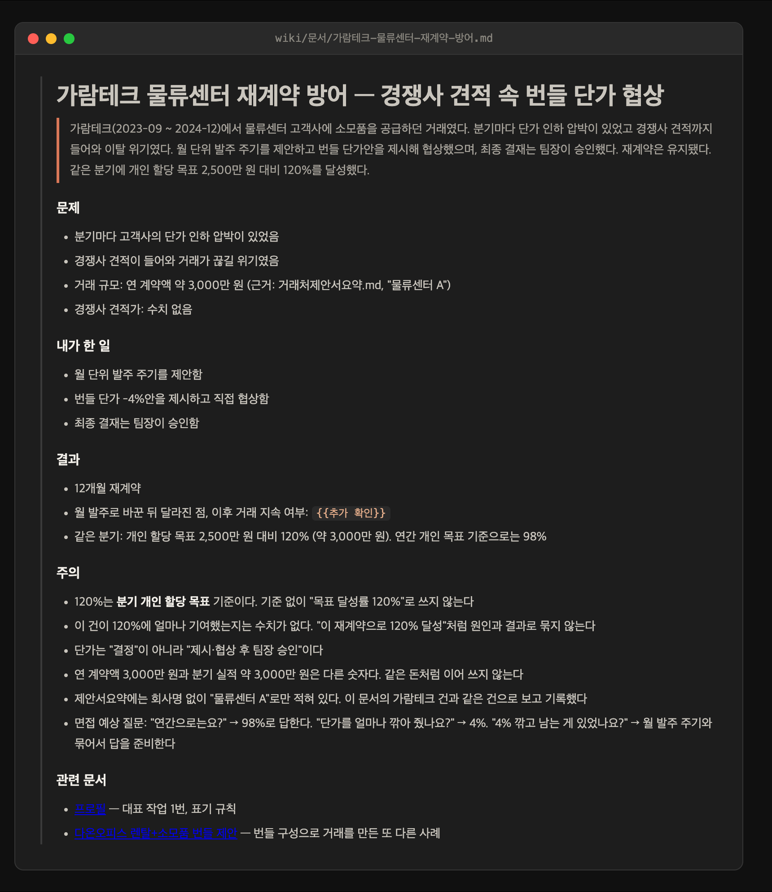

# 내 위키 만들기 — 경험을 꺼내 쓸 수 있는 상태로

경력 위키를 **처음 만들고, 문서 하나하나를 채워 가는** 가이드다. 아래 예시는 전부 QA 검증 런(영업 직군 시뮬레이션)에서 실제로 만들어진 위키에서 가져왔다.

위키가 왜 필요한가 — 이력서는 공고마다 다시 쓰지만, **경험 자체는 한 번만 제대로 기록하면 된다.** 그 기록이 위키다. 위키가 있으면 공고 판정은 위키를 기준으로 돌고, 서류는 위키에서 꺼내 쓰고, 면접 답변도 위키의 「주의」 절에서 나온다.

## 차례

1. [뼈대는 온보딩이 만든다](#1-뼈대는-온보딩이-만든다)
2. [문서 하나 만들기 — 실제 과정](#2-문서-하나-만들기--실제-과정)
3. [완성된 문서 해부](#3-완성된-문서-해부)
4. [직군별로 무엇을 문서로 만드나](#4-직군별로-무엇을-문서로-만드나)
5. [프로필과 연결하기](#5-프로필과-연결하기)
6. [웹 챗봇판에서는](#6-웹-챗봇판에서는)
7. [몇 개나, 언제까지](#7-몇-개나-언제까지)

---

## 1. 뼈대는 온보딩이 만든다

위키 폴더를 손으로 만들 필요 없다. 온보딩(`/chwijun-copilot:wiki-bootstrap`, 웹 챗봇은 "온보딩")이 인터뷰를 끝내면 이 구조가 생긴다:

```
wiki/
├── 프로필.md      ← 판정 기준. 대표 작업이 아래 문서들로 링크된다
├── 개요.md        ← 진입점 + {{추가 확인}} 모음
├── 지원현황.md    ← 지원 트래커
└── 문서/
    ├── 가람테크-물류센터-재계약-방어.md     ← 소재 1개 = 문서 1개
    ├── 다온오피스-신규개척-퍼널.md
    └── 다온오피스-렌탈소모품-번들.md
```

온보딩 인터뷰에서 말한 대표 실적이 곧 첫 문서 2~4개가 된다. 그러니 **위키 만들기의 절반은 온보딩에서 성실하게 답하는 것**이다.

## 2. 문서 하나 만들기 — 실제 과정

새 소재가 생기면(또는 온보딩 때 못 다룬 경험이 기억나면) 과정은 세 단계다. QA 런에서 실제로 오간 흐름 그대로 보여준다.

**① 말로 불러준다** — 형식 없이, 기억나는 대로:

```
가람테크에서 물류센터 소모품 재계약을 지켰어요. 월 발주 주기를 제안하고
번들 단가를 제가 협상했습니다. 그 분기 목표 달성률 120%였어요.
```

**② 교정 질문에 답한다** — 그대로 받아 적지 않고, 문서가 되기 전에 확인한다:

> **120%는 누구의 목표 대비인가요? 그리고 이 재계약 건이 그 120%에 얼마나 기여했나요?** 예를 들어 팀 목표 120%를 개인 성과처럼 쓰면 면접에서 바로 드러납니다. 기여분을 모르면 "모름"이라고 하셔도 됩니다.

여기서의 답("분기 개인 할당 2,500만 원 기준이에요. 연간으로는 98%였어요", 기여분은 "그건 없어요")이 전부 문서에 반영된다. **모르는 건 모른다고 답하는 게 요령이다** — `{{추가 확인}}`으로 남고, 나중에 옛 메일·보고서에서 찾으면 채운다.

**③ 완성된 문서를 읽어 본다** — 실제로 만들어진 문서:



## 3. 완성된 문서 해부

위 문서의 절 하나하나가 역할이 있다 (양식: `templates/위키문서.md`):

| 절 | 역할 |
|---|---|
| **리드** (맨 위 인용) | 3~5문장으로 전모. 이것만 읽어도 말이 되게 — 서류에 옮길 때의 원형 |
| **문제** | 왜 문제였나, 숫자로. 근거 출처까지 (예: "근거: 거래처제안서요약.md") |
| **내가 한 일** | **내 몫만.** 남의 몫은 이름 붙여 구분 ("최종 결재는 팀장이 승인함") |
| **결과** | before→after. 모르는 건 `{{추가 확인}}`으로 정직하게 |
| **주의** | ⭐ 이 문서의 핵심 — 이 소재를 인용할 때 틀리기 쉬운 지점. "기준 없이 120%로 쓰지 않는다", 면접 예상 질문과 답까지. **이 절이 비어 있으면 문서가 미완성이다** |
| **관련 문서** | 프로필·다른 소재로 링크. 면접에서 이야기가 이어지는 길 |

「주의」 절이 왜 핵심인가 — 서류는 붙기 위해 쓰지만, 그 서류로 **면접에서 살아남게 하는 건 한계선**이다. "어디까지 말할 수 있고 어디부터 모른다고 해야 하는지"가 적혀 있으면, 1년 뒤 면접 전날에 읽어도 과장 없이 답할 수 있다.

## 4. 직군별로 무엇을 문서로 만드나

"대단한 프로젝트"만 문서가 되는 게 아니다. 끝났고 결과가 있는 일이면 된다:

| 직군 | 문서가 되는 소재 |
|---|---|
| 개발 | 장애 대응, 성능 개선(before→after 수치), 설계 결정과 그 이유 |
| 기획·PM | 의사결정 1건(무엇을 왜 포기했나), 지표가 움직인 기능, 이해관계 조율 |
| 디자인 | 케이스 스터디 — 문제 정의→디자인 결정→전후 지표 (단독 효과 측정 못 했으면 그 사실까지) |
| 마케팅 | 캠페인 단위 — 예산·채널·전후 지표, 무엇을 바꿔서 움직였나 |
| 영업 | 딜·거래처 단위 — 위기→행동→계약 결과, 퍼널 숫자(접촉→미팅→계약) |
| 그 외 | 반복 업무를 바꾼 것, 사고를 수습한 것, 숫자로 남은 모든 것 |

기록 시점은 **일이 끝난 직후**가 최선이다. 숫자가 아직 손에 있고, 메일·보고서를 뒤질 필요가 없을 때.

## 5. 프로필과 연결하기

문서가 생기면 프로필도 같이 움직인다 — 보통 기록을 시키면 같이 해 주지만, 확인할 곳은 세 군데다:

1. **대표 작업**: 새 문서가 기존 3~5개보다 강하면 교체, 문서로 링크
2. **공백**: 새 경험으로 메워진 항목은 삭제
3. **표기 규칙**: 기록 과정에서 정한 제한("기준 없이 120%로 쓰지 않는다")을 추가

## 6. 웹 챗봇판에서는

웹 챗봇은 파일을 저장하지 못하므로, 같은 과정을 거쳐 **완성된 문서 텍스트를 돌려준다.** 받아서 본인이 보관한다 — 프로젝트 지식(GPT Knowledge·Gem 지식)에 넣어두면 판정·서류 작업에 그대로 쓰인다. 노션·옵시디언 등 쓰던 메모 도구에 `문서/` 폴더 구조를 흉내 내서 모아 둬도 된다.

## 7. 몇 개나, 언제까지

- **시작은 온보딩이 만든 2~4개면 충분하다.** 그걸로 바로 공고 판정이 돈다
- 이후는 소재가 생길 때마다 하나씩 — 숫자를 들고 있을 때 바로
- 상한은 없지만, 프로필의 "대표 작업"은 3~5개를 유지한다. 위키는 두꺼워져도 프로필은 짧게
- 사실이 뒤집히면(숫자 정정, 알고 보니 팀 성과) **문서부터 고친다** — [워크플로우 가이드 §5](워크플로우-가이드.md#5-정정--사실이-바뀌면-위키부터)

---

다음 단계: 위키로 지원 사이클을 돌리는 법은 [워크플로우 가이드](워크플로우-가이드.md), 기록 시킬 때의 입력 형식은 [프롬프트 가이드](프롬프트-가이드.md).
